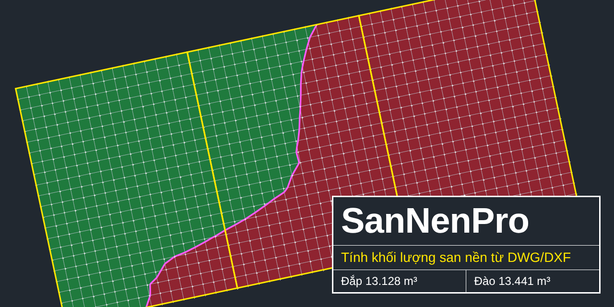
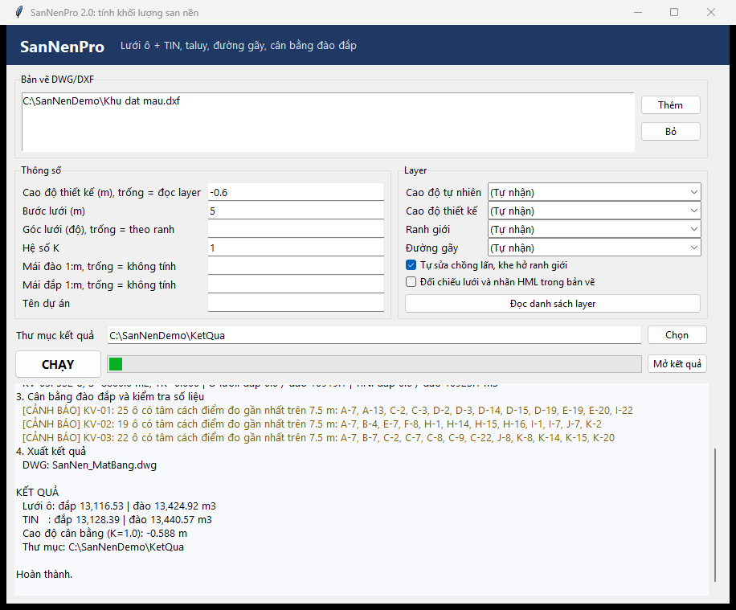
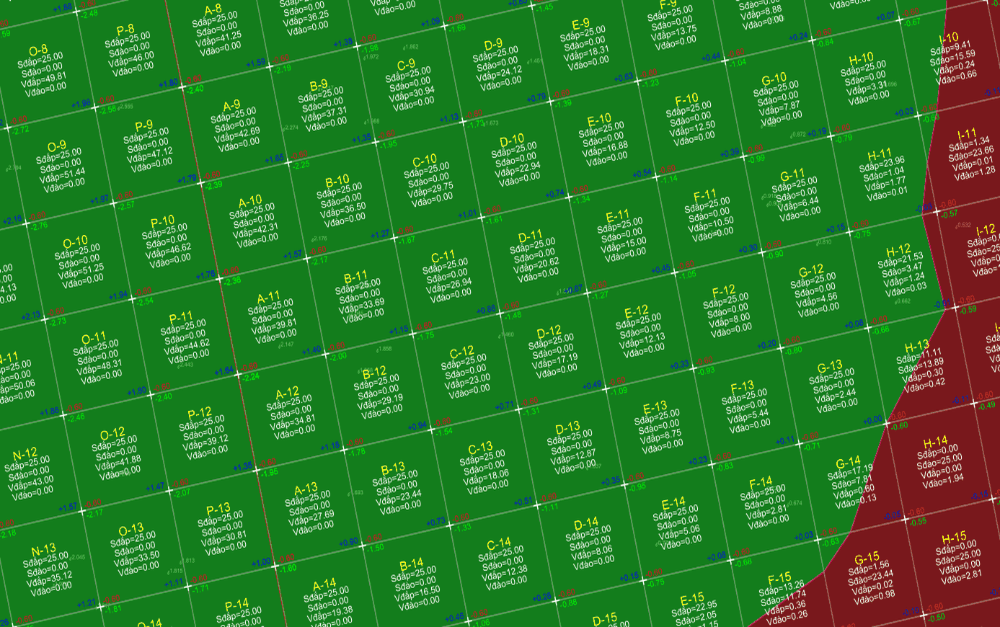

# SanNenPro

Tính khối lượng san nền từ DWG/DXF. Đọc điểm cao độ và ranh giới trong bản vẽ, chia lưới ô, tính đào đắp từng ô rồi xuất Excel, DWG, PDF.



**[Tải bản Windows 2.1 (99 MB)](https://github.com/huyhoang31897-stack/SanNenPro/raw/main/ban-chay/SanNenPro_v2.1.zip)** · [Trang giới thiệu, có video](https://huyhoang31897-stack.github.io/SanNenPro/) · [File mẫu](mau/)

Giải nén là chạy, không cần cài Python. Đọc file DWG cần máy có AutoCAD; không có thì lưu bản vẽ sang DXF. File chưa ký số nên Windows có thể cảnh báo khi mở lần đầu.

## Cách dùng

1. Giải nén, chạy `SanNenPro.exe`.
2. Bấm **Thêm**, chọn bản vẽ.
3. Nhập cao độ thiết kế, bước lưới, hệ số K. Có taluy thì nhập hệ số mái.
4. Bấm **CHẠY**, xong bấm **Mở kết quả**.



Muốn thử ngay: chọn file trong thư mục `Mau`, nhập cao độ thiết kế −0,6 rồi bấm **CHẠY**. Kết quả của file mẫu xem sẵn ở thư mục [`mau`](mau/).

## Bản vẽ cần có

| Dữ liệu | Dạng |
|---|---|
| Cao độ tự nhiên | TEXT, MTEXT, POINT có Z, hoặc block có thuộc tính cao độ |
| Ranh giới | Polyline kín, mỗi khu một polyline |
| Cao độ thiết kế | Nhập tay, hoặc TEXT trên layer riêng |
| Đường gãy, nếu có | Line hoặc polyline, tên layer có chữ `break` hoặc `duong gay` |

Tên layer tùy ý, chương trình tự nhận. Nhận sai thì bấm **Đọc danh sách layer** và chọn lại.

## Kết quả

| File | Nội dung |
|---|---|
| `SanNen_KhoiLuong.xlsx` | Bảng từng khu, tổng hợp, cân đối đất theo K, cân bằng đào đắp, taluy, kiểm tra số liệu |
| `SanNen_MatBang.dwg` | Lưới, cao độ nút, đào đắp từng ô, đường 0, chân taluy |
| `SanNen_BaoCao.pdf` | Bản đồ đào đắp, tổng hợp, đường cong cân bằng, cảnh báo |



## Cách tính

- **Lưới ô:** `V = S × trung bình |h|` các đỉnh ô, tách theo đường h = 0.
- **TIN:** cắt tam giác theo ô và tích phân; đường gãy được ép thành cạnh tam giác.
- **Taluy:** mái 1:m từ mép ranh giới đến khi gặp mặt đất, tính trên lưới 0,5 m, rộng tối đa 30 m.
- **Nhiều khu:** phần chồng lấn tính cho khu đứng trước, khe hở nhập vào khu kề.

## Đã kiểm tra

20 bài toán có đáp số tính tay đều đạt (`test_sannen.py`). Đối chiếu với HML trên 649 ô của một công trình thực tế, 617 ô lệch không quá 0,02. 32 ô còn lại lệch do làm tròn cao độ nút hoặc do đỉnh có h = 0.

## Ví dụ thực tế

Khu đất 7 khu vực, khoảng 16.400 m², đã tính bằng HML. Chạy lại bằng SanNenPro cho thấy khu cuối sót 14 ô (191 m², khoảng 59 m³), 4 chỗ ranh giới chồng lấn tổng 55 m² bị tính hai lần và 21 m² khe hở chưa được tính.

| Lưới ô, m³ | Bảng cũ | Sau khi sửa |
|---|---:|---:|
| Đắp | 1.198,61 | 1.268,92 |
| Đào | 3.602,83 | 3.593,54 |
| Đất thừa, K = 1 | 2.404,22 | 2.324,62 |

## Trong AutoCAD

Mở `SanNenPro.exe` một lần, dùng `APPLOAD` nạp `sannen.lsp`. Lệnh `SANNEN` mở chương trình với bản vẽ đang mở, lệnh `SANNENKQ` chèn kết quả đúng tọa độ.

## Chưa làm được

- Taluy tính cho cả chu vi ngoài, chưa chọn được từng cạnh.
- Chưa tính bóc phong hoá, cọc, hầm, hố móng.
- Cao độ cân bằng chưa gồm taluy.

Xem sheet Kiểm tra trong file Excel và tự rà lại số liệu trước khi dùng.

## Chạy từ mã nguồn

Cần Python 3.10 trở lên. Chạy `CAI_DAT.bat` một lần, rồi:

```bash
python sannen_gui.py
python sannen.py "ban ve.dwg" --td -0.6 --step 5 --k 1.15
python sannen.py a.dwg b.dwg --td 2.5 --taluy-dao 1 --taluy-dap 1.5 --out KetQua
python test_sannen.py
```

## Tác giả

Hoàng HH. Báo lỗi hoặc góp ý tại [Issues](https://github.com/huyhoang31897-stack/SanNenPro/issues). Giấy phép [MIT](LICENSE).
