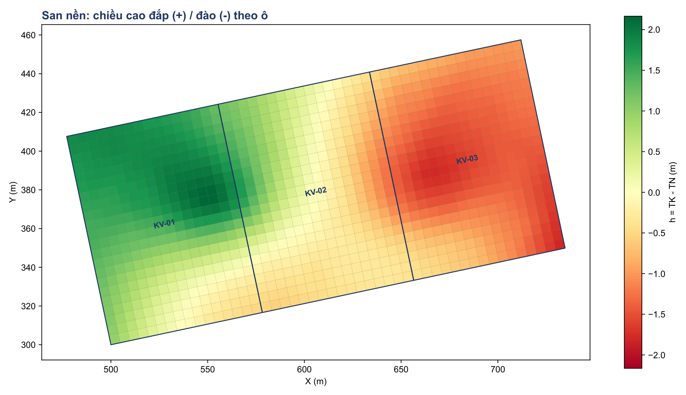
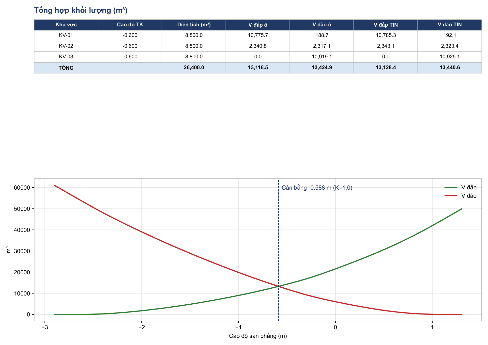

<p align="center"></p>

<p align="center"><b>Tính khối lượng san nền trực tiếp từ bản vẽ CAD, xuất sẵn Excel, DWG và PDF.</b></p>

<p align="center">
  <a href="https://github.com/huyhoang31897-stack/SanNenPro/raw/main/ban-chay/SanNenPro_v2.0.zip"><b>⬇ Tải cho Windows (99 MB)</b></a>
  &nbsp;·&nbsp; Không cần cài Python
</p>

## Tính năng

| | |
|---|---|
| **Hai cách tính** | Lưới ô và mô hình TIN chạy song song để đối chiếu |
| **Taluy** | Nhập hệ số mái đào, đắp; xuất khối lượng và chân taluy |
| **Đường gãy** | TIN ép theo mép mương, bờ taluy |
| **Cân bằng đào đắp** | Cao độ cân bằng, đường cong khối lượng, cân đối đất theo hệ số K |
| **Ranh giới** | Hình bất kỳ, nhiều khu, tự cắt chồng lấn và lấp khe hở |
| **Kiểm tra số liệu** | Điểm trùng, điểm dị thường, ô thiếu điểm đo, chênh lệch hai cách tính |
| **AutoCAD** | Lệnh `SANNEN` mở tool, `SANNENKQ` chèn kết quả đúng tọa độ |
| **Tự nhận layer** | Không cần đổi tên layer của bản vẽ |

## Hình ảnh

| Giao diện | Bản đồ đào đắp |
|---|---|
|  |  |

| Mặt bằng CAD | Tổng hợp, cân bằng |
|---|---|
|  |  |

<sub>Hình dùng khu đất mẫu giả lập.</sub>

## Hướng dẫn sử dụng

**Yêu cầu:** Windows. Đọc file DWG cần máy có AutoCAD; không có thì lưu bản vẽ sang DXF. File chưa ký số nên Windows có thể cảnh báo khi mở lần đầu.

1. Tải file ở đầu trang, giải nén, giữ nguyên thư mục.
2. Chạy `SanNenPro.exe`, bấm **Thêm** và chọn bản vẽ.
3. Nhập cao độ thiết kế, bước lưới, hệ số K. Có taluy thì nhập hệ số mái (ví dụ 1 và 1,5).
4. Bấm **CHẠY**, xong bấm **Mở kết quả**.

### Chuẩn bị bản vẽ

| Dữ liệu | Dạng |
|---|---|
| Cao độ tự nhiên | TEXT số, MTEXT số, POINT có Z, block có thuộc tính cao độ |
| Ranh giới | Polyline kín, mỗi khu một polyline |
| Cao độ thiết kế | Nhập tay, hoặc TEXT số trên layer riêng |
| Đường gãy (nếu có) | Line, polyline trên layer có chữ `break` hoặc `duong gay` |

Tool nhận sai layer thì bấm **Đọc danh sách layer** và chọn lại.

### Dùng trong AutoCAD

1. Mở `SanNenPro.exe` một lần.
2. Trong AutoCAD gõ `APPLOAD`, chọn `sannen.lsp`.
3. Gõ `SANNEN` để mở tool với bản vẽ hiện hành.
4. Tính xong gõ `SANNENKQ` để chèn kết quả.

### Kết quả

| File | Nội dung |
|---|---|
| `SanNen_KhoiLuong.xlsx` | Tổng hợp, bảng từng khu, cân đối đất, cân bằng, taluy, kiểm tra |
| `SanNen_MatBang.dwg` / `.dxf` | Ranh giới, lưới, cao độ nút, hatch đào đắp, đường 0, chân taluy, bảng tổng hợp |
| `SanNen_BaoCao.pdf` | Bản đồ đào đắp, tổng hợp, đường cong cân bằng, cảnh báo |

File gốc không bị sửa.

## Cách tính

- **Lưới ô:** `V = S × trung bình |h|` các đỉnh ô, tách theo đường h = 0.
- **TIN:** cắt tam giác theo ô, tích phân chính xác; đường gãy được ép thành cạnh tam giác.
- **Taluy:** mái 1:m từ mép ranh giới ra ngoài đến khi gặp mặt đất, tính trên lưới 0,5 m, rộng tối đa 30 m.
- **Ranh giới:** phần chồng lấn thuộc khu đứng trước, khe hở nhập vào khu kề.

Đã kiểm thử bằng 20 bài toán có đáp số tính tay (`test_sannen.py`) và đối chiếu với HML trên 649 ô thực tế: 617 ô lệch không quá 0,02; các ô còn lại do làm tròn cao độ nút hoặc cách xử lý đỉnh có h = 0.

## Giới hạn

- Taluy áp dụng cho toàn bộ chu vi ngoài, chưa chọn được từng cạnh.
- Chưa tính bóc phong hoá, cọc, hầm, hố móng.
- Cao độ cân bằng chưa gồm taluy.
- Kết quả cần được kỹ sư kiểm tra trước khi sử dụng. Xem sheet `Kiểm tra` trong Excel.

## Chạy từ mã nguồn

Cần Python 3.10 trở lên. Chạy `CAI_DAT.bat` một lần, rồi:

```bash
python sannen_gui.py
python sannen.py "ban ve.dwg" --td -0.6 --step 5 --k 1.15
python sannen.py a.dwg b.dwg --td 2.5 --taluy-dao 1 --taluy-dap 1.5 --out KetQua
python test_sannen.py
```
